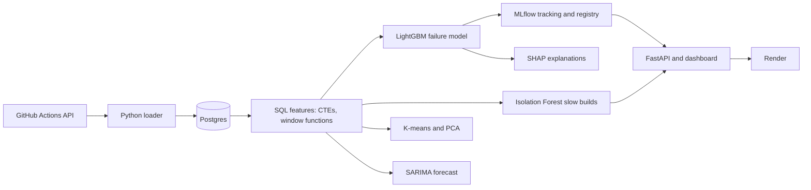

# CI Radar

Predicts failing builds and flags unusually slow builds for public GitHub projects (pandas, numpy, scikit-learn, flask).

Live demo: https://ci-radar.onrender.com
## Data
- Source: GitHub Actions API, March to August 2026, 4 repos
- 13,886 builds, 1,409 failures (10.1%), stored in Postgres
- SQL features use CTEs, window functions and joins. Each build only sees earlier builds, so there is no leakage.

## Results (time-based split: 70% train, 15% validation, 15% test)
| Model | Test PR-AUC |
|---|---|
| Random guessing | 0.104 |
| Baseline (fail_rate_last10) | 0.435 |
| LightGBM | 0.555 |
| LightGBM tuned with Optuna (30 trials) | 0.516 |

Tuning raised validation PR-AUC (0.612 to 0.624) but not test PR-AUC. The test set has about 217 failures, so scores are noisy.
All runs are tracked in MLflow. The model is registered as ci-radar-risk and is promoted only if it beats production by 0.01 validation PR-AUC.

- Flaky candidates (sql/flaky.sql): commits with both a passing and failing run, pandas 434, scikit-learn 120, numpy 117, flask 80. Without workflow names, some are different checks rather than true flakiness.

## Precision and recall (test set)
- LightGBM, threshold 0.35 chosen on validation: precision 0.652, recall 0.417, F1 0.508.
- Class weights did not help: PR-AUC 0.546, precision 0.738, recall 0.417, F1 0.533.
- PR-AUC by repo: numpy 0.917, flask 0.265, pandas 0.228, scikit-learn 0.064. The overall score is carried mostly by numpy. Flask (12 failures) and scikit-learn (17 failures) are noisy.
- Precision-recall curve: notebooks/pr_curve.png

## Explainability (SHAP)
- Most important features by average SHAP impact: is_pr 1.06, fail_rate_last10 0.54, repo 0.41, fail_rate_last50 0.27. builds_in_window had no effect.
- Example: the highest-risk build in a sample (risk 0.80) was a flask build with a 56% failure rate over the last 50 builds.
- Chart: notebooks/shap_importance.png

## Flaky candidates by workflow, 4 repos (older run)
- Same workflow, same commit, both a pass and a fail (builds Mar to Aug 2026):
  - scikit-learn/scikit-learn: 17 commits
  - pallets/flask: 1 commits
  - numpy/numpy: 1 commits
  - pandas-dev/pandas: 1 commits
- Still not per-test flakiness: a re-run after an infrastructure error also counts.

## Architecture

## Seven repos (django, requests, fastapi added)
- Test results on all 7 repos: PR-AUC 0.456, precision 0.573, recall 0.326, F1 0.415 (threshold 0.30 chosen on validation). Class weights hurt: PR-AUC 0.358.
- PR-AUC by repo: requests 0.929, numpy 0.867, fastapi 0.264, pandas 0.224, flask 0.220, django 0.110, scikit-learn 0.080.
- The model is strong on numpy and requests and weak on the other repos. The 0.555 result above is the earlier 4-repo model. The live dashboard now serves the 7-repo model (PR-AUC 0.456).

## Flaky candidates by workflow (sql/flaky_by_workflow.sql)
- Same workflow, same commit, both a pass and a fail (builds Mar to Aug 2026):
  - fastapi/fastapi: 40 commits
  - scikit-learn/scikit-learn: 17 commits
  - django/django: 14 commits
  - psf/requests: 2 commits
  - pallets/flask: 1 commits
  - numpy/numpy: 1 commits
  - pandas-dev/pandas: 1 commits
- Still not per-test flakiness: a re-run after an infrastructure error also counts.

- Correction: the earlier commit-level count (about 751) was too high, because one commit runs several workflows. Comparing only the same workflow on the same commit gives 76 commits across 7 repos. Most come from bot or check workflows (Smokeshow, PR Quality Checks, Check Changelog), which often pass after a pull request text edit. Real test workflows show only a few (scikit-learn Unit tests 2, numpy 1, pandas 1, flask 1).
